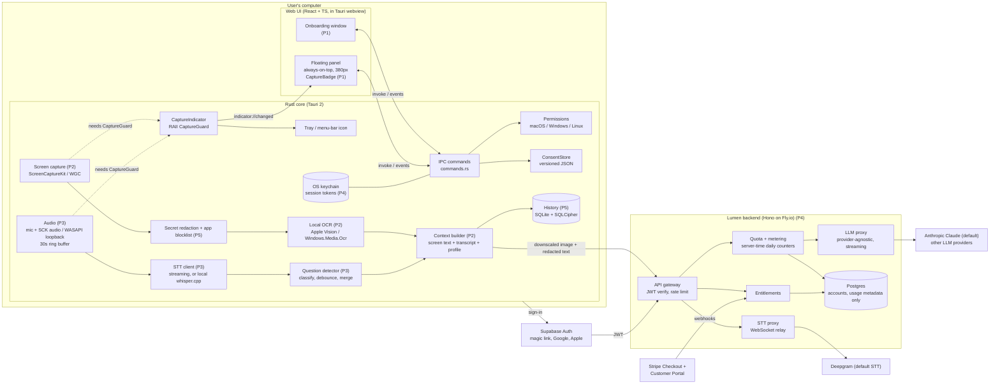
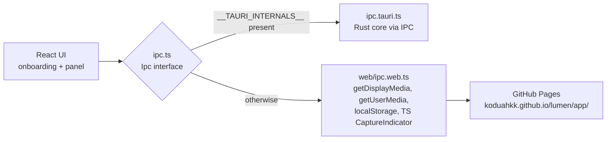
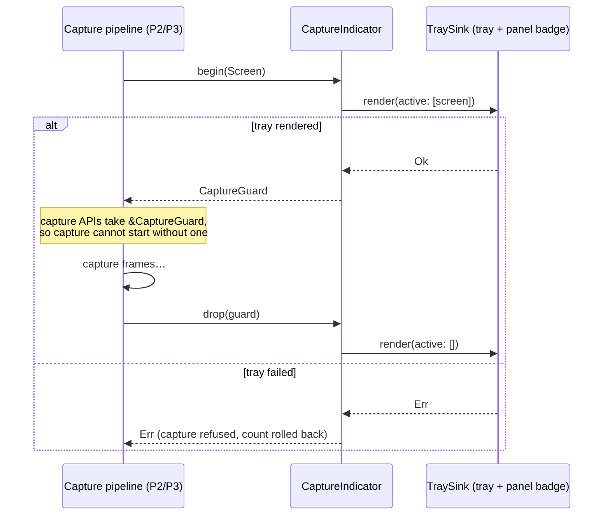

# Lumen architecture

Status: Phase 1 implemented (scaffold, permissions onboarding, capture indicator).
Boxes marked *(P2–P6)* are planned and drawn here so later phases slot in without
reshaping the system.

## System overview



## Desktop and web share one UI



## Capture indicator invariant

The acceptance criterion "indicator visible 100% of the time capture is
active" is enforced in the type system, not just by convention:



OS capture indicators (the macOS purple/orange dot, the Windows yellow border)
are never suppressed, and no Lumen window ever enables content protection.
`scripts/check-no-content-protection.mjs` fails CI if one does.

## Answer path latency budget (target p50 first token < 1.5 s)

| Step | Budget |
| --- | --- |
| Capture + downscale (to 1280px long edge) | 80 ms |
| Local OCR + redaction | 150 ms |
| TLS request to backend (kept-alive connection) | 60 ms |
| Backend auth + quota check (in-memory cache, async write) | 20 ms |
| LLM time to first token (Claude, streaming, prompt-cached system prompt) | 900 ms |
| Render first token | 10 ms |
| **Total** | **≈ 1.2 s** |

## Repository layout

```
lumen/
  crates/lumen-core/        pure Rust: permissions model, indicator, consent (unit-tested on every OS)
  apps/desktop/             Tauri 2 app
    src/                    React UI (onboarding, panel)
    src-tauri/              Rust shell: IPC commands, tray, platform permission backends
    e2e/                    Playwright happy path with a fake IPC bridge
  apps/backend/             (P4) Hono API
  apps/landing/             (P6) marketing + pricing page
  scripts/                  repo guards used in CI
  docs/                     architecture, acceptable use
```
